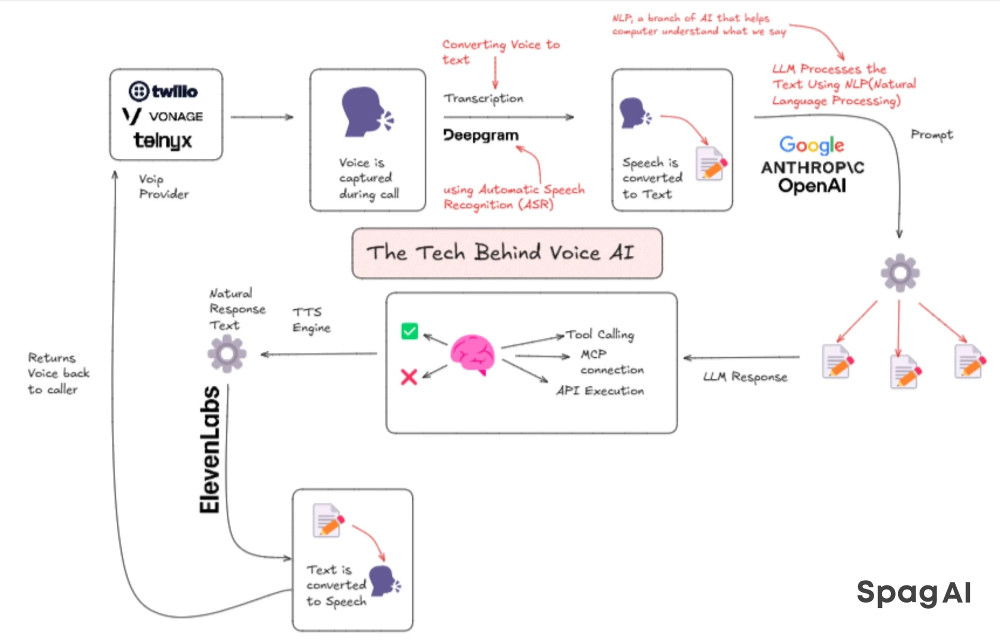

# The Spag AI Brain

This folder is Spag AI's thinking space for voice AI: how it works, how we get to **our own locally trained Nigerian voices**, what to learn, who to hire and what it costs. Come here to look something up, brainstorm, and write down decisions.

It is not product documentation. For the app itself, see `/README.md` and `/docs`.

## The goal in one paragraph

Retell, Vapi, Bland and ElevenLabs let businesses build voice agents, but their voices and speech recognition are built for American and European speech. They sound foreign to a Nigerian caller and miss what Nigerian callers say, especially in Pidgin, Yoruba, Hausa and Igbo, or when people mix languages mid-sentence. **Spag AI's edge is local voices.** We record and train voices that sound like real Nigerians, train speech recognition that understands Nigerians, and offer both inside an agent platform built for the Nigerian market (Sir and Ma, calling hours, Naira billing). That platform already exists as a prototype in this repository.

## How to use this folder

| File | Read it when you want to know... |
|---|---|
| [01-how-voice-ai-works.md](01-how-voice-ai-works.md) | What happens, step by step, between "Hello?" and the agent's reply. Uses the illustration above. |
| [02-the-stack-rent-vs-own.md](02-the-stack-rent-vs-own.md) | The options at each layer (phone line, ears, brain, mouth, the code that joins them), what we rent and what we should own. |
| [03-local-voices-strategy.md](03-local-voices-strategy.md) | What "local voices" means, why it is hard, the stages we climb, and where our moat comes from. |
| [04-training-playbook.md](04-training-playbook.md) | Step by step: recording a voice actor and training a voice; fine-tuning speech recognition. |
| [05-datasets.md](05-datasets.md) | Open speech data for Nigerian English, Pidgin, Yoruba, Hausa, Igbo, and whether we may use it commercially. |
| [06-learning-path.md](06-learning-path.md) | What to read, watch and build, in order, for the founders and for new engineers. |
| [07-team-and-hiring.md](07-team-and-hiring.md) | Who we need, in what order, where to find them and how to test them. |
| [08-compute-and-costs.md](08-compute-and-costs.md) | GPUs, hosting, and rough costs for training and for serving calls. |
| [09-legal-consent-ethics.md](09-legal-consent-ethics.md) | Voice actor consent and contracts, the Nigeria Data Protection Act, deepfake safeguards. |
| [10-roadmap.md](10-roadmap.md) | A milestone plan from today's prototype to our own voices in production. |
| [11-brainstorm-log.md](11-brainstorm-log.md) | Open questions, ideas, and decisions as we make them. **Add to this one freely.** |
| [glossary.md](glossary.md) | Words like ASR, TTS, VAD, WER, MOS, barge-in, fine-tuning. |

## The five things to remember

1. **A voice agent is a relay race:** phone line → ears (speech-to-text) → brain (language model) → mouth (text-to-speech) → phone line. Each runner adds delay. A caller notices any gap longer than about one second.
2. **Don't train everything at once.** Rent the brain (language models are a commodity). **Own the mouth and the ears for Nigerian speech.** That is where foreign providers are weak and where our data becomes the moat.
3. **Data beats models.** Open-source TTS and ASR models are good and free. What nobody else has is clean, consented, licensed recordings of Nigerian voices with accurate transcripts, including tone marks for Yoruba and Igbo.
4. **Phone audio is not studio audio.** Calls carry 8 kHz audio, compressed. Train and test for that, not for headphones.
5. **Consent is the product.** Every voice comes from a paid, informed, contracted voice actor who can see how their voice is used. That makes us trustworthy to banks and telcos and keeps us out of deepfake trouble.

## Where we are today (November 2026)

- The Studio prototype runs agents with **rented** voices (Fish Audio's Nigerian-accented voices, decision D111 in `docs/DECISIONS.md`) and mock phone lines.
- `services/voice-worker` is a starter for the live call loop (LiveKit Agents or Pipecat), not yet connected to a phone line.
- `packages/core/data/names-pronunciation.json` is an unverified start on Nigerian name pronunciation.
- No voices of our own yet. That is what this brain is for.

## How to add to the brain

- Keep the language plain. Someone new should understand it.
- When you decide something, write it in `11-brainstorm-log.md` with the date and the reason.
- When a fact can change (prices, licences, which model is best), write the date you checked it. This field changes every few months.
