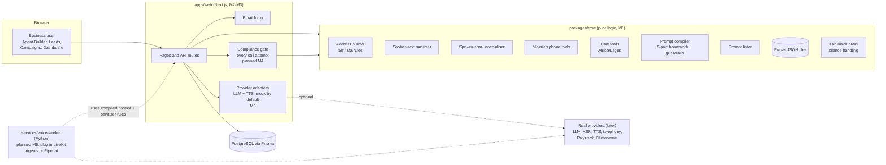
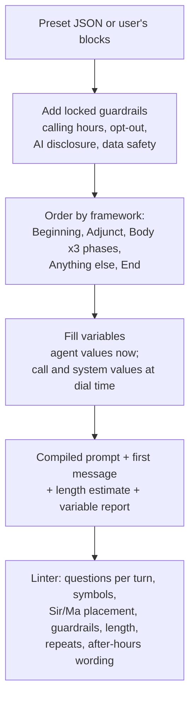
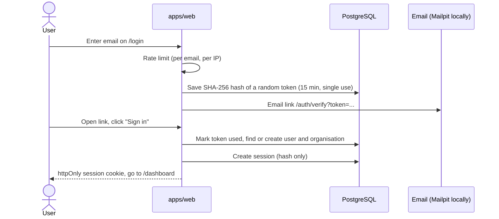
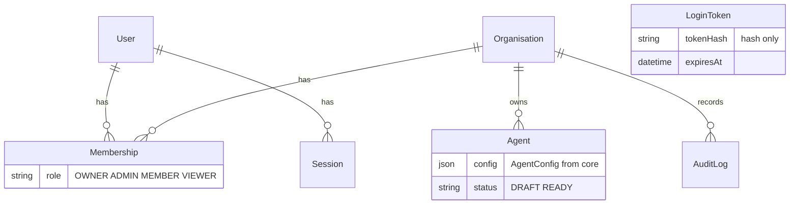
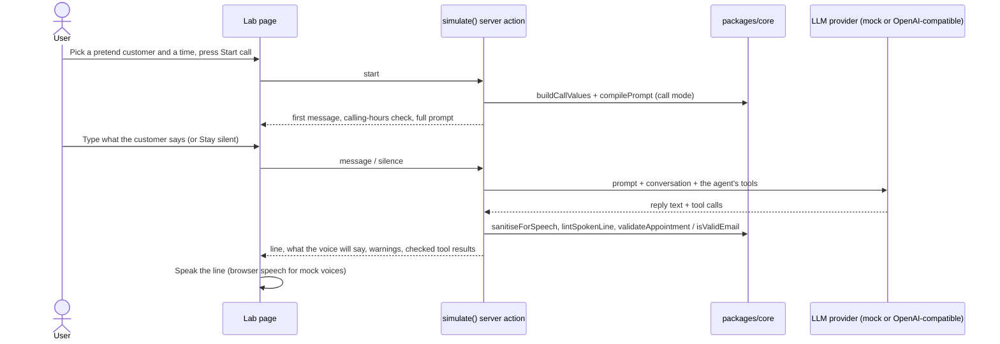
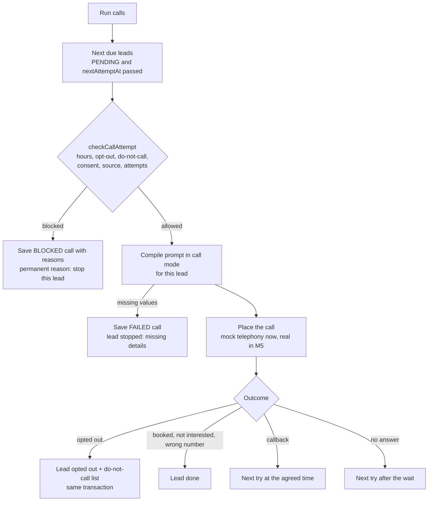
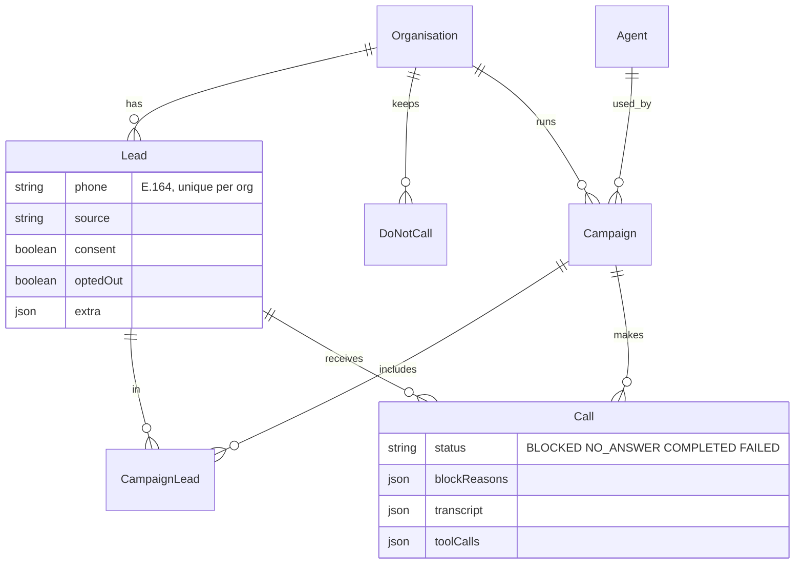
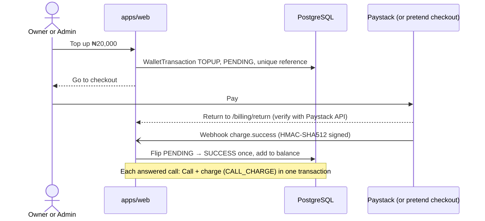

# Architecture

> Updated each milestone. Parts marked *(planned)* do not exist yet.

## The big picture

## Rules of the road

1. **`packages/core` is pure.** No network, no database, no reading the clock unless a `Date` is passed in. That makes every rule testable and reusable by the website, the simulator and (via an API) the voice worker.
2. **Everything outside is behind an interface.** LLM, speech-to-text, text-to-speech, telephony and payments each have an interface with a **mock** adapter. Real ones are switched on through environment variables (see `.env.example`).
3. **One gate for every call.** *(planned M4)* Every call attempt passes through one compliance function (calling hours, opt-out, do-not-disturb, consent, lead source). The reason for every block is logged.
4. **Text is cleaned before it is spoken.** Every line the agent says goes through `sanitiseForSpeech` before text-to-speech.
5. **Time is always Africa/Lagos (WAT). Money is always integer kobo.**

## packages/core modules

| Module | Main functions | Used by |
|---|---|---|
| `address` | `buildAddress`, `checkAddressRule` | Prompt runtime values, linter |
| `speech` | `sanitiseForSpeech` | TTS path, demo |
| `email` | `normaliseSpokenEmail`, `emailToSpeech` | save_lead_data tool, sanitiser |
| `phone` | `parseNigerianPhone`, `formatNigerianPhone`, `phoneToSpeech` | Lead import, sanitiser |
| `time` | `isWithinCallingWindow`, `isWithinBookingWindow`, `validateAppointment`, `getTimeOfDay`, `chooseGoodbye` | Compliance, booking tools, prompt runtime |
| `prompt` | `compilePrompt`, `lintPrompt`, `lintSpokenLine`, `buildCallValues` | Agent Builder, simulator, dialer |
| `agent` | `TOOL_DEFINITIONS`, `DEFAULT_SILENCE`, `presetSchema` | Agent Builder, presets |
| `presets` | `PRESETS`, `getPreset`, `presetToTemplate` | Agent Builder |
| `names` | `getNamePronunciation` | Future TTS pronunciation hints |

## How a prompt is built

## Signing in (magic link)

## apps/web layout

| Folder | Purpose |
|---|---|
| `src/app/login`, `src/app/auth/verify` | Public sign-in pages (server actions) |
| `src/app/(app)/…` | Signed-in pages. The layout calls `requireOrg()`, which redirects to /login if needed. |
| `src/app/(app)/agents/actions.ts` | Create, save (server-side guardrail enforcement and readiness check) and delete agents |
| `src/app/(app)/settings/actions.ts` | Rename organisation, invite, change roles, remove members |
| `src/server/auth` | Tokens, login links, sessions |
| `src/server/permissions.ts` | Role rules (pure, tested) |
| `src/server/rate-limit.ts` | In-memory rate limiter (pure, tested) |
| `src/components/agent-builder` | The Agent Builder: tabs, blocks editor, live preview panel |
| `src/i18n` | Translation files and helpers |

## Data model (M2)

## The simulator (M3)

| Folder | Purpose |
|---|---|
| `packages/core/src/simulator` | Mock agent brain, day and time parsing, silence turns (pure, tested) |
| `apps/web/src/server/providers` | `getLlm()` and `synthesise()`: mock and OpenAI-compatible adapters |
| `apps/web/src/app/(app)/lab` | Lab pages (formerly the Simulator) and the `simulate` server action |
| `apps/web/src/app/(app)/voices` | Voice library page and the `previewVoice` server action |
| `apps/web/src/components/voice` | `useSpeaker` hook (browser speech or audio) and the Play button |

## Campaigns and the compliance gate (M4)

### Data model added in M4

## Billing (M5)

## Voice worker (M5 starter)

`services/voice-worker` (Python, FastAPI) will run the live call loop. Today it validates call requests,
checks the shared secret, and cleans lines through `POST /api/voice/sanitise` on the web app.
